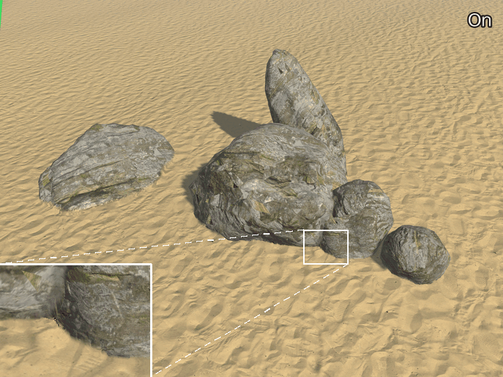
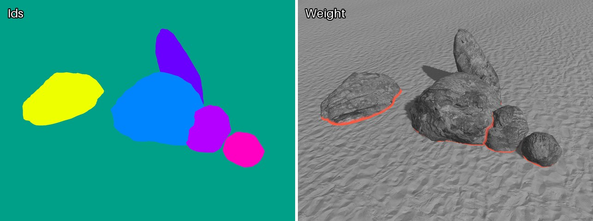

# Mesh Blend

**Soft contacts for Unity URP.** Where a rock enters the terrain, a wall stands on the ground or two boulders are
pushed into each other, real-time rendering draws a hard, perfectly straight cut. Mesh Blend softens that line in
screen space, so the two surfaces fade into each other. It needs no changes to your materials, meshes, terrain or URP
itself.



## Features

- Works with any opaque shader and with Unity Terrain, including the GPU Resident Drawer.
- No URP fork, no material or shader changes, nothing to bake.
- The band is measured on the surfaces in the world, so it holds its shape as the camera moves.
- Its width follows the angle between the surfaces: wide where they meet nearly flat, narrow at a right angle, and
  never more than a share of a small stone's size.
- Surface groups by rendering layer, each with its own share of the band and a priority, and a matrix of which
  groups blend with which. Where the ground outranks a rock, the rock fades into the ground and the ground keeps
  its own colour: the seam stays hidden and sand rises onto the rock, but none of the rock's grey spreads over the
  sand.
- A world-anchored raggedness on the band's outer edge, so it does not read as a ruler line.
- Optionally lets a sharp seam's line show through the blend.
- Keeps URP's SSAO from smearing the crease's darkness across the seam.

## Requirements

- Unity 6000.3 or newer with URP 17.3 or newer, using Render Graph (Compatibility Mode is not supported). Tested on
  6000.3 and 6000.4.
- Perspective cameras. Orthographic cameras, overlay cameras and XR are skipped.

## Installation

**Package Manager (git URL).** *Window ▸ Package Manager ▸ + ▸ Install package from git URL…*

```
https://github.com/realdegrees/meshblend.git?path=Packages/com.realdegrees.meshblend
```

Append `#v1.0.0` (any version tag) to pin a version. Or add it to `Packages/manifest.json`:

```json
"com.realdegrees.meshblend": "https://github.com/realdegrees/meshblend.git?path=Packages/com.realdegrees.meshblend#v1.0.0"
```

**Demo.** The package ships a demo scene as a sample: the same rock cluster on grass, dirt and sand, with CC0
textures. In the Package Manager, select *Mesh Blend ▸ Samples ▸ Demo ▸ Import*; it is copied to
`Assets/Samples/Mesh Blend/<version>/Demo` (scene, rocks, terrain, textures and a volume profile, nothing else), and
deleting that folder removes it again. Do steps 1 and 2 of the setup below with layers 1, 2 and 3, and open
`MeshBlendDemo.unity`; its rocks and terrain are already tagged.

**Clone.** The repository root is a Unity project with the package embedded, set up to show the demo:

```
git clone https://github.com/realdegrees/meshblend.git
```

Open the folder in Unity 6000.4 or newer and run *Mesh Blend ▸ Open Demo For Editing*, then open
`Assets/Samples/Mesh Blend/Demo/MeshBlendDemo.unity`.

## Setup

1. **Rendering layers.** In *Project Settings ▸ Tags and Layers ▸ Rendering Layers*, name three layers, for example
   `Mesh Blend`, `Mesh Blend Narrow` and `Mesh Blend Ground`. The feature's default groups use layers 1, 2 and 3,
   which is also what the demo scene uses.
2. **Renderer feature.** On your URP Renderer asset, *Add Renderer Feature ▸ Mesh Blend*. Its default surface groups
   are *Rocks* (layer 1, the full band), *Buildings & Props* (layer 2, half the band) and *Ground* (layer 3, a ground
   group with priority 1). Change their layers, add groups (up to seven) and set the blend matrix as you need.
3. **Tag renderers.** Add each group's layer to the *Rendering Layer Mask* of its renderers: rocks and cliffs, building
   pieces and props, and your Terrain (*Terrain ▸ Settings ▸ Rendering Layer Mask*) or ground meshes. Everything in a
   ground group counts as one surface.
4. **Volume.** On a Volume, *Add Override ▸ Mesh Blend* and raise *Intensity* above 0.

## Settings

On the **Volume override** (the look, blendable per area like any post effect):

| Setting | Default | |
|---|---|---|
| Intensity | 0 | How much of the other side is mixed in. 0 switches the effect off and records no passes. |
| Right Angle Radius | 0.06 m | Band width on each side where the surfaces meet at 90° or steeper. |
| Flat Radius | 0.5 m | Band width where the surfaces meet nearly flat. |
| Flat Falloff | 4 | How quickly the band narrows from the flat radius toward the right-angle one as the contact steepens: at 4 the flat radius holds only within a few degrees of flat and a 45° contact is close to the right-angle radius; 1 narrows it evenly with the angle. |
| Sharp Seams | 0 | How much of the seam line shows through where the surfaces meet at a sharp angle. 0 blends it away. |
| Noise | 0.4 | How ragged the band's outer edge is. The seam itself never moves. |
| Noise Size | 0.1 m | Size of the raggedness pattern, fixed to the world. |
| Occlusion | 0.1 | How much URP SSAO stays near a contact. |
| Occlusion Reach | 0.5 m | How far from a contact the SSAO is flattened, independent of the band. Set it to about your SSAO radius. |
| Max Distance | 100 m | Distance from the camera beyond which the blend has faded out. |

On the **Renderer Feature** (the wiring):

| Setting | Default | |
|---|---|---|
| Surface Groups | Rocks, Buildings & Props, Ground | Which renderers take part, by rendering layer. Per group: *Band Share* (its share of the band; where two groups meet the smaller applies), *Priority* (0 to 3; where groups meet, the lower one fades into the higher one, which keeps its own colour; equal priorities meet in an even mix) and *Ground* (drawn with its own depth pass and counted as one surface, for terrain). |
| Blend Matrix | all on | Which groups blend with each other where they meet. |
| Search Reach | 0.25 | How far the seam search reaches, as a share of the screen height. Very close up a band can be wider than this on screen; it fades out toward the reach instead of being cut. Every doubling costs one more short pass. |
| Debug View | None | *Ids* colours every taking-part surface, *Weight* shows the blend in red. |

`MeshBlendRendererFeature.ForcedDebugView` switches the debug view from code, for an in-game debug menu.

## How it works

Roughly: before the opaque pass, the taking-part renderers are drawn once more into an id buffer, one id per object,
and the ground renderers are drawn with their own depth pass so the terrain counts as one surface. Pixels next to a
different surface they actually touch in the world mark a seam, and a
[jump flood](https://www.comp.nus.edu.sg/~tants/jfa.html) hands every nearby pixel the closest seam. After the opaque
pass, the pixels beside a seam fade into the other surface's own pixels, mirrored across the seam, so both sides show
the same pixels where they meet. Further out a surface keeps its own detail and lighting and only takes on the other
side's colour, so a wide band carries no second copy of the ground's shadows. The angle, the distance to the contact
and the raggedness that shape the band are all measured on the surfaces in the world, so the band holds still as the
camera moves.



The renderer feature's *Debug View* shows both: *Ids* colours every taking-part surface (the ground in brown), *Weight*
shows how much of the mix each pixel takes in red.

Cost scales with screen resolution, not with scene size: a handful of full-screen passes plus one extra draw of the
taking-part renderers.

## Limits

- Opaque surfaces only.
- Taking-part renderers are drawn with a plain id shader, so alpha clipping and vertex animation are ignored when
  finding the seam. Rocks and buildings are fine; foliage is not a good fit.
- Statically batched objects share one id and so do not blend into each other.
- It is a screen-space effect: a seam hidden behind something else is not blended, and the far side of a contact that
  is out of view cannot be sampled.

## Sources and credits

- The seam search follows the mesh blend shaders of [Wicked Engine](https://github.com/turanszkij/WickedEngine) by
  Turánszki János, MIT licensed: an id buffer, and a jump flood that hands each pixel its nearest seam. See
  [THIRD-PARTY-NOTICES](Packages/com.realdegrees.meshblend/THIRD-PARTY-NOTICES.md).
- Taking each object's id as a hash of its world position comes from Jack Tollenaar's write-up
  [Mesh seam smoothing & blending](https://sites.google.com/view/jack-tollenaar/mesh-seam-smoothing-blending).
- The demo's textures are CC0 from [ambientCG](https://ambientcg.com) (see `Samples~/Demo/Textures/SOURCES.md` in
  the package); its rocks are generated by `tools/blender/rocks.py`.

## License

[MIT](LICENSE).
